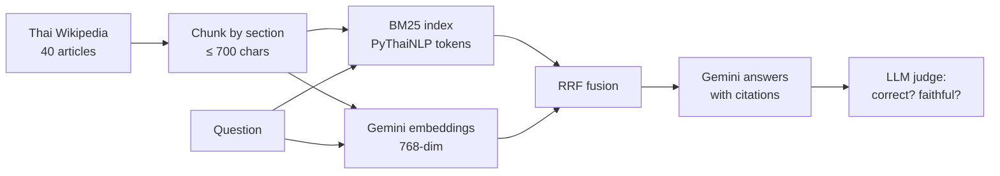

# Thai RAG with evaluation

Question answering in Thai over 40 Thai Wikipedia articles (provinces and well-known places), with a harness that **measures** how well it works instead of eyeballing a few demo questions.

It compares three ways of finding the right passage:

- **BM25**: keyword search. Thai has no spaces between words, so text is first segmented with PyThaiNLP (`newmm`).
- **Vector**: Gemini embeddings (`gemini-embedding-001`) and cosine similarity.
- **Hybrid**: both lists merged with reciprocal rank fusion (RRF).

Answers are generated by Gemini from the retrieved passages only, with numbered citations, and checked by an LLM judge for correctness and faithfulness.

## Results

Run on 1,698 chunks from 40 articles, with 80 generated questions (`gemini-embedding-001`, `gemini-2.5-flash`).

### Retrieval

| retriever | chunk hit@1 | chunk hit@3 | chunk hit@5 | chunk MRR | doc hit@1 |
|---|---|---|---|---|---|
| bm25 | 0.838 | 0.950 | 0.963 | 0.898 | 0.912 |
| vector | 0.887 | **1.000** | **1.000** | **0.942** | **0.988** |
| hybrid | **0.900** | 0.988 | 0.988 | **0.942** | 0.963 |

- Vector search finds the source passage in the top 3 for every question; BM25 misses 4 of 80.
- Hybrid puts the exact passage first most often, but ties vector on MRR and is slightly worse at picking the right article first. On this question set, hybrid does not clearly beat vector alone. One question is 1.25 points, so the gaps between vector and hybrid are within noise.
- BM25's typical failure is a shared word with the wrong meaning: for "วัดพระแก้วสร้างในสมัยรัชกาลใด" it ranks the "เขาแก้ว" section of Khao Yai second, because both contain "แก้ว".

### Refusing what the corpus cannot answer

10 hand-written questions about places and facts outside the corpus ([eval/unanswerable.txt](eval/unanswerable.txt)): the system answered "ไม่พบข้อมูลในเอกสาร" for **10 / 10** instead of using outside knowledge.

### Answer quality

A first run on 40 questions scored 39/40 correct and 40/40 faithful. Reviewing every miss by hand showed the measurement was the weak part, not the system:

- **Wrong reference answer (q011):** the generated reference said 4 bus companies; the passage lists 5, and the system answered 5. The reference was corrected in `eval/questions.jsonl`.
- **Lenient judge (q029):** the Wikipedia article says Loei is 540 km from Bangkok in one section and 520 km in another. The system answered 540 from the passage it retrieved, and the judge accepted it against a reference of 520. The judge prompt now requires numbers, years and names to match exactly.

> The answer-quality numbers will be re-run with the stricter judge and the corrected reference on all 80 questions.

## How it works



| Step | Choice | Why |
|---|---|---|
| Chunking | Paragraphs merged up to 700 characters, never across a section; "References" and "See also" sections dropped | Keeps each passage on one topic; reference lists are noise |
| Chunk text for search | `title — section` + passage | A passage about "history" is useless without knowing which province it belongs to |
| Keyword search | BM25 over PyThaiNLP `newmm` tokens, Thai stopwords removed | Whitespace splitting does not work for Thai |
| Fusion | RRF (k = 60) over the top 20 of each retriever | Uses ranks only, so BM25 scores and cosine similarities never need the same scale |
| Generation | Answer only from the passages, cite `[n]`, say "ไม่พบข้อมูลในเอกสาร" otherwise | Makes hallucinations visible and measurable |

## Evaluation method

- **Question set**: 80 questions, one per sampled passage (at most 3 per article), written by Gemini with the instruction to name the subject explicitly and not copy long phrases. Each question records its source passage, which is the "gold" answer for retrieval.
- **Retrieval metrics**: chunk hit@k (the exact source passage is in the top k), chunk MRR, and doc hit@k (any passage from the right article).
- **Answer metrics**: correctness against the reference answer and faithfulness to the retrieved passages, both judged by Gemini; abstention rate; citation rate.

### Known limitations

- Questions generated from a single passage favour retrievers that match its wording, and the gold label ignores other passages that may also answer the question. Doc hit@k softens the second problem.
- The same model family writes the questions, answers them and judges them. Results show relative differences between retrievers better than absolute quality.
- 40 articles and 80 questions is a small benchmark. Treat differences of a few points as noise.

## Run it

```bash
pip install -r requirements-dev.txt
cp .env.example .env          # then add GEMINI_API_KEY
pytest                        # 33 tests, no API key needed

python scripts/fetch_corpus.py              # already done: data/corpus.jsonl
python -m thairag ingest                    # chunk + embed -> index/
python -m thairag ask "ดอยอินทนนท์สูงกี่เมตร"
python -m thairag make-questions            # eval/questions.jsonl
python -m thairag eval-retrieval            # eval/results/retrieval.md
python -m thairag eval-answers --limit 80   # eval/results/answers_hybrid.json
python -m thairag eval-abstention           # eval/results/abstention_hybrid.json
```

## Project layout

| Path | Contents |
|---|---|
| `thairag/chunking.py` | Section-aware chunking |
| `thairag/tokenize.py` | Thai word segmentation for BM25 |
| `thairag/retrievers.py` | BM25, vector and hybrid (RRF) retrievers |
| `thairag/gemini.py` | Gemini embeddings and generation with retry |
| `thairag/rag.py` | Prompting and answering with citations |
| `thairag/evaluate.py`, `metrics.py`, `questions.py` | Evaluation harness |
| `data/` | Corpus, titles and licence notes |
| `tests/` | pytest suite with fake embedder and LLM |

## Data licence

Corpus text comes from Thai Wikipedia under CC BY-SA 4.0. See [data/SOURCES.md](data/SOURCES.md).
